<!--
/*************************************************************
 *   PROJECT : YERAYLOIS GITHUB PROFILE                      *
 *   FILE    : README.md                                     *
 *   PURPOSE : PUBLIC PROFILE OVERVIEW (ES/EN)               *
 *   AUTHOR  : Yeray Lois Sanchez                            *
 *   EMAIL   : yerayloissanchez@gmail.com                    *
 *************************************************************/
-->

  <picture>
    <source media="(prefers-color-scheme: dark)" srcset="./assets/header/header-dark-en.svg" />
    <source media="(prefers-color-scheme: light)" srcset="./assets/header/header-light-en.svg" />
    
  </picture>

  <picture>
    <source media="(prefers-color-scheme: dark)" srcset="./assets/header/tab-dark-en.svg" />
    <source media="(prefers-color-scheme: light)" srcset="./assets/header/tab-light-en.svg" />
    
  </picture>

#### 𝐀𝐁𝐎𝐔𝐓 𝐌𝐄

Computer Engineering graduate from UDC (2021-2025), focused on embedded systems, automation and execution-oriented developer tooling.

<h4 align="center">𝐆𝐈𝐓𝐇𝐔𝐁 𝐌𝐄𝐓𝐑𝐈𝐂𝐒</h4>

  <picture>
    <source media="(prefers-color-scheme: dark)" srcset="./assets/metrics/base.svg" />
    
  </picture>

#### 𝐖𝐄𝐄𝐊𝐋𝐘 𝐏𝐑𝐎𝐉𝐄𝐂𝐓 𝐒𝐏𝐎𝐓𝐋𝐈𝐆𝐇𝐓

  <a href="https://github.com/yeraylois/zephyr">
    <picture>
      <source media="(prefers-color-scheme: dark)" srcset="./assets/spotlight/current-dark-en.svg" />
      <source media="(prefers-color-scheme: light)" srcset="./assets/spotlight/current-light-en.svg" />
      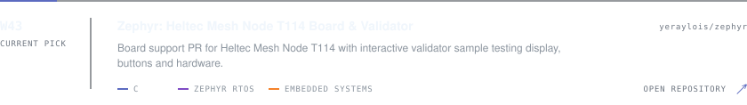
    </picture>
  </a>

#### 𝐂𝐎𝐍𝐓𝐑𝐈𝐁𝐔𝐓𝐈𝐎𝐍 𝐒𝐍𝐀𝐊𝐄

<picture>
  <source media="(prefers-color-scheme: dark)" srcset="https://raw.githubusercontent.com/yeraylois/yeraylois/output/github-contribution-grid-snake-dark.svg" />
  <source media="(prefers-color-scheme: light)" srcset="https://raw.githubusercontent.com/yeraylois/yeraylois/output/github-contribution-grid-snake.svg" />
  
</picture>

#### 𝐓𝐄𝐂𝐇 𝐒𝐓𝐀𝐂𝐊

  <picture>
    <source media="(prefers-color-scheme: dark)" srcset="./assets/stack/stack-dark-en.svg" />
    <source media="(prefers-color-scheme: light)" srcset="./assets/stack/stack-light-en.svg" />
    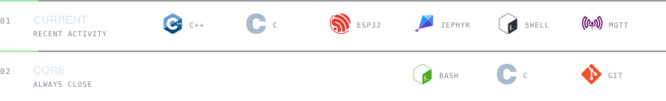
  </picture>

#### 𝐅𝐄𝐀𝐓𝐔𝐑𝐄𝐃 𝐏𝐑𝐎𝐉𝐄𝐂𝐓𝐒

  <a href="https://github.com/yeraylois/zephyr">
    <picture>
      <source media="(prefers-color-scheme: dark)" srcset="./assets/cards/project-zephyr_t114-dark-en.svg" />
      <source media="(prefers-color-scheme: light)" srcset="./assets/cards/project-zephyr_t114-light-en.svg" />
      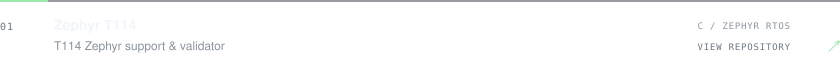
    </picture>
  </a>
   
  <a href="https://github.com/zephyrproject-rtos/zephyr/pull/108610">
    <picture>
      <source media="(prefers-color-scheme: dark)" srcset="./assets/cards/project-zephyr_lvgl_upstream-dark-en.svg" />
      <source media="(prefers-color-scheme: light)" srcset="./assets/cards/project-zephyr_lvgl_upstream-light-en.svg" />
      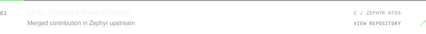
    </picture>
  </a>

#### 𝐂𝐎𝐍𝐓𝐀𝐂𝐓

  <a href="mailto:yerayloissanchez@gmail.com">
    <picture>
      <source media="(prefers-color-scheme: dark)" srcset="./assets/cards/contact-email-dark-en.svg" />
      <source media="(prefers-color-scheme: light)" srcset="./assets/cards/contact-email-light-en.svg" />
      
    </picture>
  </a>
   
  <a href="https://www.linkedin.com/in/yeray-lois">
    <picture>
      <source media="(prefers-color-scheme: dark)" srcset="./assets/cards/contact-linkedin-dark-en.svg" />
      <source media="(prefers-color-scheme: light)" srcset="./assets/cards/contact-linkedin-light-en.svg" />
      
    </picture>
  </a>
   
  <a href="https://github.com/yeraylois">
    <picture>
      <source media="(prefers-color-scheme: dark)" srcset="./assets/cards/contact-github-dark-en.svg" />
      <source media="(prefers-color-scheme: light)" srcset="./assets/cards/contact-github-light-en.svg" />
      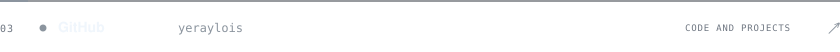
    </picture>
  </a>

  <picture>
    <source media="(prefers-color-scheme: dark)" srcset="./assets/footer/footer-dark-en.svg" />
    <source media="(prefers-color-scheme: light)" srcset="./assets/footer/footer-light-en.svg" />
    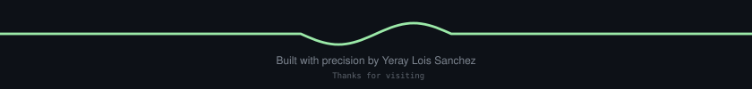
  </picture>

  <picture>
    <source media="(prefers-color-scheme: dark)" srcset="./assets/header/tab-dark-es.svg" />
    <source media="(prefers-color-scheme: light)" srcset="./assets/header/tab-light-es.svg" />
    
  </picture>

#### 𝐒𝐎𝐁𝐑𝐄 𝐌𝐈

Graduado en Ingeniería Informática por la UDC (2021-2025), enfocado en sistemas embebidos, automatización y desarrollo de herramientas orientadas a ejecución real.

<h4 align="center">𝐌𝐄𝐓𝐑𝐈𝐂𝐀𝐒 𝐆𝐈𝐓𝐇𝐔𝐁</h4>

  <picture>
    <source media="(prefers-color-scheme: dark)" srcset="./assets/metrics/base-es.svg" />
    
  </picture>

#### 𝐏𝐑𝐎𝐘𝐄𝐂𝐓𝐎 𝐒𝐄𝐌𝐀𝐍𝐀𝐋

  <a href="https://github.com/yeraylois/zephyr">
    <picture>
      <source media="(prefers-color-scheme: dark)" srcset="./assets/spotlight/current-dark-es.svg" />
      <source media="(prefers-color-scheme: light)" srcset="./assets/spotlight/current-light-es.svg" />
      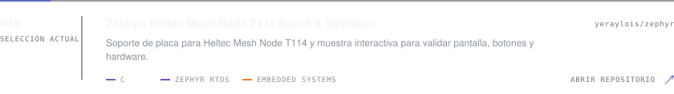
    </picture>
  </a>

#### 𝐒𝐍𝐀𝐊𝐄 𝐃𝐄 𝐂𝐎𝐍𝐓𝐑𝐈𝐁𝐔𝐂𝐈𝐎𝐍𝐄𝐒

<picture>
  <source media="(prefers-color-scheme: dark)" srcset="https://raw.githubusercontent.com/yeraylois/yeraylois/output/github-contribution-grid-snake-dark-es.svg" />
  <source media="(prefers-color-scheme: light)" srcset="https://raw.githubusercontent.com/yeraylois/yeraylois/output/github-contribution-grid-snake-es.svg" />
  
</picture>

#### 𝐒𝐓𝐀𝐂𝐊 𝐓𝐄𝐂𝐍𝐎𝐋𝐎𝐆𝐈𝐂𝐎

  <picture>
    <source media="(prefers-color-scheme: dark)" srcset="./assets/stack/stack-dark-es.svg" />
    <source media="(prefers-color-scheme: light)" srcset="./assets/stack/stack-light-es.svg" />
    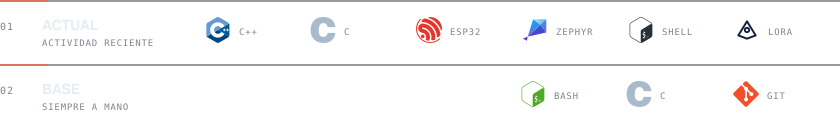
  </picture>

#### 𝐏𝐑𝐎𝐘𝐄𝐂𝐓𝐎𝐒 𝐃𝐄𝐒𝐓𝐀𝐂𝐀𝐃𝐎𝐒

  <a href="https://github.com/yeraylois/zephyr">
    <picture>
      <source media="(prefers-color-scheme: dark)" srcset="./assets/cards/project-zephyr_t114-dark-es.svg" />
      <source media="(prefers-color-scheme: light)" srcset="./assets/cards/project-zephyr_t114-light-es.svg" />
      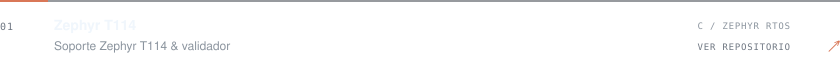
    </picture>
  </a>
   
  <a href="https://github.com/zephyrproject-rtos/zephyr/pull/108610">
    <picture>
      <source media="(prefers-color-scheme: dark)" srcset="./assets/cards/project-zephyr_lvgl_upstream-dark-es.svg" />
      <source media="(prefers-color-scheme: light)" srcset="./assets/cards/project-zephyr_lvgl_upstream-light-es.svg" />
      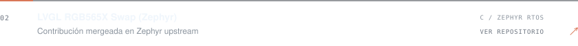
    </picture>
  </a>

#### 𝐂𝐎𝐍𝐓𝐀𝐂𝐓𝐎

  <a href="mailto:yerayloissanchez@gmail.com">
    <picture>
      <source media="(prefers-color-scheme: dark)" srcset="./assets/cards/contact-email-dark-es.svg" />
      <source media="(prefers-color-scheme: light)" srcset="./assets/cards/contact-email-light-es.svg" />
      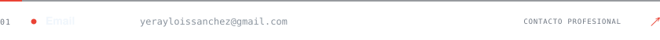
    </picture>
  </a>
   
  <a href="https://www.linkedin.com/in/yeray-lois">
    <picture>
      <source media="(prefers-color-scheme: dark)" srcset="./assets/cards/contact-linkedin-dark-es.svg" />
      <source media="(prefers-color-scheme: light)" srcset="./assets/cards/contact-linkedin-light-es.svg" />
      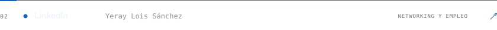
    </picture>
  </a>
   
  <a href="https://github.com/yeraylois">
    <picture>
      <source media="(prefers-color-scheme: dark)" srcset="./assets/cards/contact-github-dark-es.svg" />
      <source media="(prefers-color-scheme: light)" srcset="./assets/cards/contact-github-light-es.svg" />
      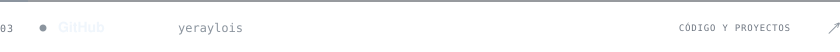
    </picture>
  </a>

  <picture>
    <source media="(prefers-color-scheme: dark)" srcset="./assets/footer/footer-dark-es.svg" />
    <source media="(prefers-color-scheme: light)" srcset="./assets/footer/footer-light-es.svg" />
    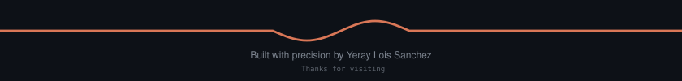
  </picture>

